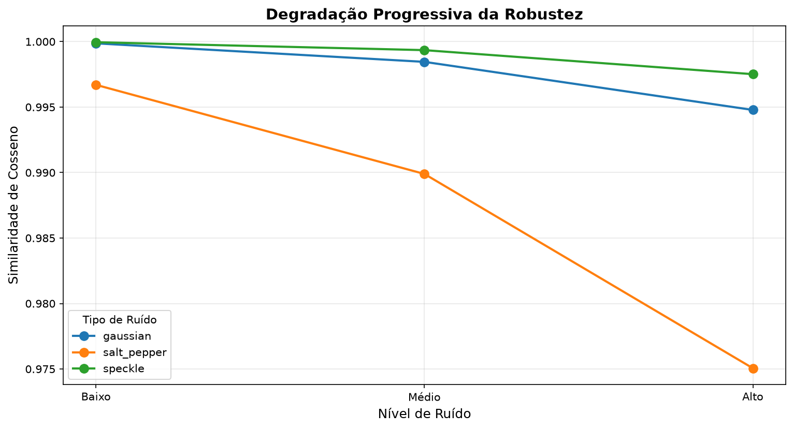
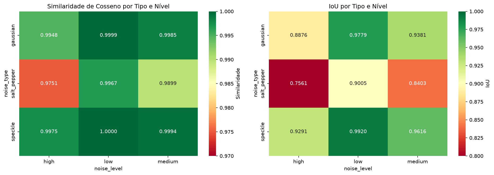
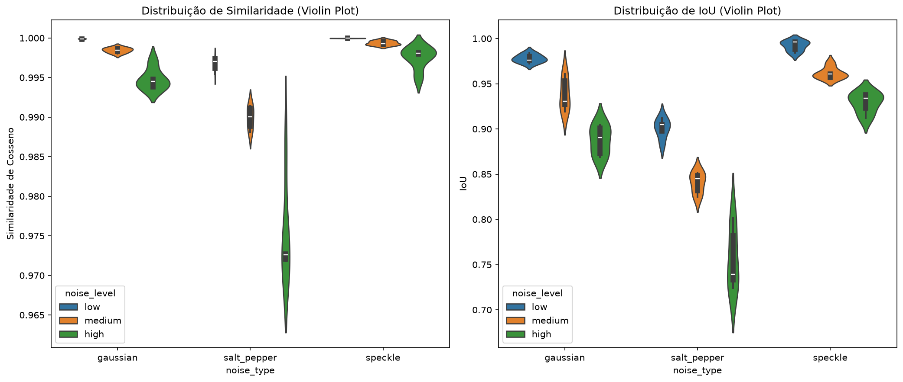
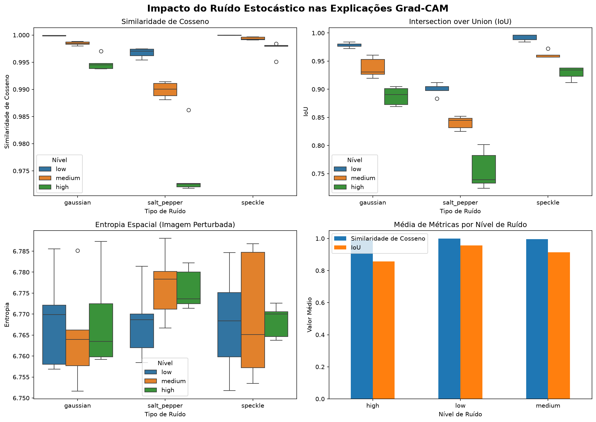

# Efeito do Ruído na Robustez de Mapas Grad-CAM (ResNet-50)

[](https://www.python.org/)
[](https://pytorch.org/)
[](#)
[](#)
[](#)

Experimento científico e quantitativo que investiga a estabilidade e a robustez das explicações visuais geradas pelo algoritmo **Grad-CAM** sobre uma rede neural **ResNet-50** (ImageNet) sob perturbações físicas e estocásticas de sensor.

---

## 📌 1. Proposta Experimental e Métricas Objetivas

Diferente de avaliações meramente empíricas ou subjetivas, o pipeline mede a divergência dos mapas de ativação através de formulações matemáticas rigorosas:

- **Similaridade de Cosseno:** Mede a congruência angular e proporcionalidade global dos gradientes.
- **Intersection over Union (IoU):** Mede a sobreposição espacial da área de foco de atenção (limiar binarizado em 50%).
- **Diferença de Entropia Espacial ($\Delta H$):** Mede a dispersão estocástica e a perda de concentração focal.

---

## 📊 2. Resultados Validados da Execução Real

> *Validação realizada em 12/10/2026 sobre 45 avaliações empíricas com PyTorch 2.14 e SciPy 1.18.*

### 2.1. Ranking de Robustez por Família de Ruído

| Família de Ruído | Similaridade Cosseno | IoU Médio | Degradação IoU | Impacto Observado |
| :--- | :---: | :---: | :---: | :--- |
| **Speckle (Multiplicativo)** | **0,9989 ± 0,0013** | **0,9609 ± 0,0277** | **3,91%** | Maior resiliência; perturbação proporcional ao brilho local |
| **Gaussiano (Aditivo)** | **0,9977 ± 0,0023** | **0,9345 ± 0,0404** | **6,55%** | Resiliência moderada; espalha gradiente uniformemente |
| **Sal e Pimenta (Impulsivo)**| **0,9872 ± 0,0100** | **0,8323 ± 0,0645** | **16,77%** | **Maior degradação; corrompe regiões locais de ativação** |

### 2.2. Testes de Hipótese e Significância (ANOVA)
- **Impacto do Tipo de Ruído:** $F = 17,52$, $p\text{-value} = 0,0000$ ($p < 0,05$ — altamente significativo).
- **Impacto da Intensidade (Low / Med / High):** $F = 7,87$, $p\text{-value} = 0,0013$ ($p < 0,05$ — significativo).
- **Correlação Cosseno x IoU:** $r = 0,9318$ (forte consistência entre as duas métricas).

---

## 🖼️ 3. Evidências Visuais Selecionadas

| Dimensão Analítica | Evidência Gráfica |
| :--- | :--- |
| **Tendência de Degradação** |  |
| **Heatmap por Tipo e Nível** |  |
| **Violin Plot de Variabilidade** |  |
| **Distribuição Geral** |  |

---

## ⚙️ 4. Instruções de Reprodução

1. **Instale as dependências:**
   ```bash
   pip install -r requirements.txt
   ```

2. **Execute o experimento de perturbação e geração de mapas:**
   ```bash
   python experiment_optimized.py
   ```
   *Gera a base `results/metrics.csv` e gráficos em `results/plots/`.*

3. **Gere a análise estatística detalhada (ANOVA, correlações e heatmaps):**
   ```bash
   python analysis.py
   ```

---

## 📁 5. Estrutura do Repositório

```text
efeito_ruido/
├── data/                                         # Datasets locais de suporte (CIFAR-10)
├── evidencias/                                   # Gráficos em alta resolução e logs
│   ├── degradation_trend.png
│   ├── heatmap_analysis.png
│   ├── metrics_analysis.png
│   ├── violin_analysis.png
│   └── log_execucao_real.txt
├── results/                                      # Saídas da execução real
│   ├── plots/
│   └── metrics.csv                               # 45 registros de avaliação experimental
├── experiment_optimized.py                       # Pipeline completo ResNet-50 + Grad-CAM
├── analysis.py                                   # Análise estatística e testes ANOVA
├── test_image.jpeg                               # Imagem de entrada
├── Efeito_Ruido_Relatorio_Publicacao.docx        # Relatório executivo completo em Word
├── APRESENTACAO.md                               # Roteiro de pitch e divulgação
├── requirements.txt                              # Dependências Python
└── README.md                                     # Documentação técnica
```

---

## 📄 6. Material de Publicação para Portfólio

O relatório executivo diagramado em Word, contendo a contextualização para papers, análise estatística aprofundada e roteiro editorial para redes profissionais, está disponível em [`Efeito_Ruido_Relatorio_Publicacao.docx`](file:///d:/projetos/efeito_ruido/Efeito_Ruido_Relatorio_Publicacao.docx).
